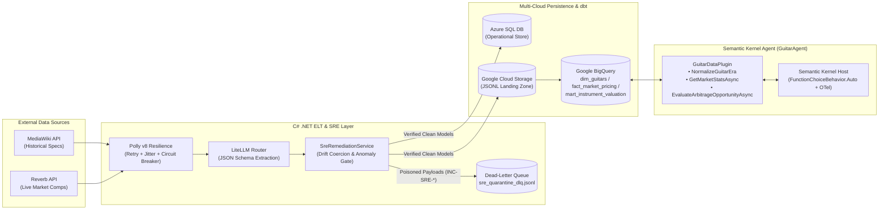

# guitar-etl-pipeline v2.0: Autonomous Multi-Agent ELT, SRE Self-Healing & Market Arbitrage Engine


**Author:** Eric Simpson | Site Reliability & AI/Data Platform Engineer  
**Stack:** C# (.NET 8 / .NET 10) • Microsoft Semantic Kernel • Polly v8 Resilience • LiteLLM Proxy (Model Routing & Fallbacks) • dbt Core • Google BigQuery & Cloud Storage • Azure SQL Database • xUnit

---

## 1. Executive Architecture Summary

`guitar-etl-pipeline v2.0` is a production-grade, multi-cloud **Autonomous Data & Decision Platform** bridging **Data Engineering**, **LLMOps**, and **Site Reliability Engineering (SRE)**:

1. **Resilient Multi-Cloud Extraction & LLM Entity Parsing ([`Program.cs`](Program.cs), [`ResiliencePipelineFactory.cs`](Services/ResiliencePipelineFactory.cs))**:
   Extracts unstructured luthier history from the **MediaWiki API** and secondary-market listings from the **Reverb Developer Hub API**. All external HTTP calls are governed by **Polly v8** resilience pipelines featuring exponential backoff with jitter, HTTP `429 TooManyRequests` handling, and circuit breakers. Unstructured text is coerced into strict JSON schemas via a routed **LiteLLM Proxy** ([`config/litellm_config.yaml`](config/litellm_config.yaml)).
2. **Event-Driven SRE Self-Healing & Dead-Letter Queue ([`SreRemediationService.cs`](Services/SreRemediationService.cs))**:
   Applies production SRE auto-remediation patterns directly to ELT pipelines prior to warehouse load. Inspects raw payloads for currency schema drift (e.g., `"$925.00 USD"` strings), inverted price bounds, duplicate entity chunks, and counterfeit/negative price anomalies—autonomously healing recoverable drift, routing poisoned payloads to a Dead-Letter Queue (`sre_quarantine_dlq.jsonl` / [`quarantine_dlq.sql`](guitar_analytics/models/quarantine_dlq.sql)), and emitting structured `INC-SRE-*` incident records.
3. **Dimensional Star Schema & Automated `dbt` Quality Gates ([`guitar_analytics/`](guitar_analytics/))**:
   Stages verified JSONL snapshots to **Google Cloud Storage** and transactional **Azure SQL**, then transforms them in **Google BigQuery** via `dbt` into [`dim_guitars`](guitar_analytics/models/dim_guitars.sql), [`fact_market_pricing`](guitar_analytics/models/fact_market_pricing.sql), and [`mart_instrument_valuation`](guitar_analytics/models/marts/mart_instrument_valuation.sql) with automated schema contracts ([`schema.yml`](guitar_analytics/models/schema.yml)).
4. **Autonomous Semantic Kernel Agent & Arbitrage Engine ([`GuitarAgent/`](GuitarAgent/))**:
   An interactive **Microsoft Semantic Kernel** agent ([`GuitarAgent.Console/Program.cs`](GuitarAgent/src/GuitarAgent.Console/Program.cs)) equipped with `FunctionChoiceBehavior.Auto()`, **OpenTelemetry** distributed tracing (`ActivityListener`), and [`GuitarDataPlugin`](GuitarAgent/src/GuitarAgent.AI/Plugins/GuitarDataPlugin.cs). Autonomously normalizes vintage/Norlin/modern eras ([`EraNormalizer.cs`](GuitarAgent/src/GuitarAgent.Domain/Services/EraNormalizer.cs)), queries live BigQuery comps ([`BigQueryRepository.cs`](GuitarAgent/src/GuitarAgent.Infrastructure/BigQuery/BigQueryRepository.cs)), and computes fee-adjusted resale ROI ([`ArbitrageCalculator.cs`](GuitarAgent/src/GuitarAgent.Domain/Services/ArbitrageCalculator.cs)).

---

## 2. System Architecture & Data Flow



| Stage | Component | Source Implementation | Primary Technology | Output / Artifact |
| :--- | :--- | :--- | :--- | :--- |
| **1. Extract & Enrich** | Resilient Ingestion & LLM Parser | [`Program.cs`](Program.cs) • [`ResiliencePipelineFactory.cs`](Services/ResiliencePipelineFactory.cs) | C# .NET 8 • Polly v8 • LiteLLM | Canonical model specs + live Reverb pricing |
| **2. SRE Auto-Heal** | Schema Drift & Anomaly Gate | [`SreRemediationService.cs`](Services/SreRemediationService.cs) • [`SreIncident.cs`](Models/SreIncident.cs) | C# Regex Coercion + Dead-Letter Queue | Healed staging rows + `INC-SRE-*` incident log |
| **3. Transform & Test** | Dimensional Star Schema | [`dim_guitars.sql`](guitar_analytics/models/dim_guitars.sql) • [`fact_market_pricing.sql`](guitar_analytics/models/fact_market_pricing.sql) • [`mart_instrument_valuation.sql`](guitar_analytics/models/marts/mart_instrument_valuation.sql) | dbt Core • BigQuery • [`schema.yml`](guitar_analytics/models/schema.yml) | Validated analytical tables & DLQ view |
| **4. Era Resolution** | Luthier Era Classifier | [`EraNormalizer.cs`](GuitarAgent/src/GuitarAgent.Domain/Services/EraNormalizer.cs) | Deterministic Domain Service | Vintage (`<1970`), Norlin (`1970–1985`), Modern (`>1985`) |
| **5. Agentic Appraisal** | Autonomous Tool-Calling Agent | [`GuitarDataPlugin.cs`](GuitarAgent/src/GuitarAgent.AI/Plugins/GuitarDataPlugin.cs) • [`ArbitrageCalculator.cs`](GuitarAgent/src/GuitarAgent.Domain/Services/ArbitrageCalculator.cs) | Semantic Kernel • OpenTelemetry • BigQuery | Fee-adjusted net profit, ROI %, & `STRONG_BUY` signals |

---

## 3. Verified Arbitrage Execution Benchmarks

`ArbitrageCalculator.EvaluateDeal` evaluates secondary-market listings against Star Schema average comps after deducting Reverb selling/processing fees (`8.19% + $0.49`), inbound shipping, and a `$35.00` luthier bench setup allowance. All rows below are continuously verified by [`ArbitrageCalculatorTests.cs`](tests/GuitarEtl.Tests/ArbitrageCalculatorTests.cs):

| Listing ID | Canonical Model | Source | Ask + Inbound Ship | Bench Setup | All-In Cost | Star Schema Avg Comp | Reverb Fees (8.19% + $0.49) | Est. Net Profit | Net ROI | Signal |
| :--- | :--- | :--- | ---: | ---: | ---: | ---: | ---: | ---: | ---: | :--- |
| `REV-LIVE-102` | Gibson Les Paul Standard ('60s) | Reverb (IN) | $1,640.00 | $35.00 | $1,675.00 | $2,187.50 | $179.65 | **+$332.85** | **19.87%** | `STRONG_BUY` |
| `EBAY-LIVE-101` | Fender Stratocaster (Am Pro II) | eBay (KY) | $1,005.00 | $35.00 | $1,040.00 | $1,355.00 | $111.46 | **+$203.54** | **19.57%** | `STRONG_BUY` |
| `EBAY-LIVE-103` | Ibanez RG550 Genesis (MIJ) | eBay (OH) | $635.00 | $35.00 | $670.00 | $862.50 | $71.13 | **+$121.37** | **18.11%** | `STRONG_BUY` |

---

## 4. Local Development, Testing & CI/CD

### Run the Automated xUnit Test Suite
The solution includes 17 unit tests in [`tests/GuitarEtl.Tests/`](tests/GuitarEtl.Tests/) covering era classification, arbitrage ROI math, SRE schema drift auto-healing, Dead-Letter Queue quarantine, and Semantic Kernel plugin execution:

```bash
dotnet test GuitarEtl.sln --configuration Release --verbosity normal
```

### Run the Interactive Semantic Kernel Agent (`GuitarAgent`)
Configure your credentials via .NET User Secrets or environment variables (`AI_API_KEY`, `AI_MODEL_ID`, `GOOGLE_PROJECT_ID`, `GOOGLE_APPLICATION_CREDENTIALS`) and launch the agent:

```bash
dotnet run --project GuitarAgent/src/GuitarAgent.Console/GuitarAgent.Console.csproj
```

### Run the Multi-Cloud ELT Pipeline
Provide `REVERB_API_KEY`, `SQL_CONNECTION_STRING`, and `GCP_KEY_PATH` in your `.env` file and run:

```bash
dotnet run --project GuitarEtl.csproj
```

### Run the Autonomous Python Multi-Agent Simulation & Interactive Studio
Execute the zero-dependency Python 3.11 4-agent ELT, SRE self-healing, and arbitrage simulation ([`guitar_etl_agentic_workflow.py`](guitar_etl_agentic_workflow.py)) or open the interactive telemetry studio ([`docs/guitar_etl_agentic_studio.html`](docs/guitar_etl_agentic_studio.html)):

```bash
python guitar_etl_agentic_workflow.py
```

---

## 5. Business Intelligence Visualization
An interactive Looker Studio dashboard connected directly to the BigQuery analytical dataset allows users to filter and explore Reverb pricing trends against historical production configurations:

* [**View the Live Looker Studio Dashboard**](https://datastudio.google.com/reporting/888d714c-88e8-43d7-9555-a9a57f213e9a)
